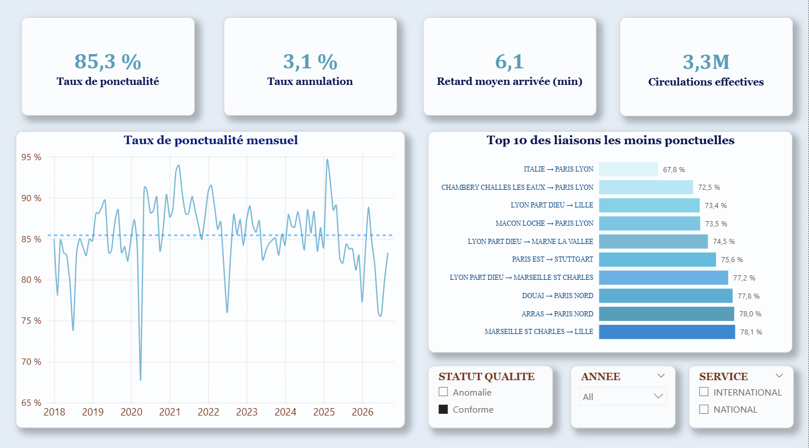

# Ponctualité du TGV : projet BI de bout en bout

Projet personnel illustrant une chaîne data complète : nettoyage (ETL), contrôle qualité, modélisation en étoile sous Snowflake, et dashboard Power BI.



## Besoin métier (fictif)

La direction souhaite suivre la ponctualité et les annulations des liaisons TGV par période et par liaison, et identifier les liaisons problématiques, en s'appuyant sur des données de qualité contrôlée.

## Architecture

```
CSV (SNCF Open Data) → Python / pandas → Snowflake (RAW → MART) → Power BI
```

| Étape | Outil | Rôle |
|---|---|---|
| Extraction | CSV open data SNCF | Régularité mensuelle TGV par liaison, 2018-2026 |
| Nettoyage et qualité | Python (pandas) | Renommage, typage, contrôles, marquage des anomalies |
| Stockage et modélisation | Snowflake | Schéma `RAW` (brut) et `MART` (modèle en étoile) |
| Restitution | Power BI | Dashboard interactif |

## Source des données

- Jeu de données : « Régularité mensuelle TGV par liaisons », SNCF Open Data (https://data.sncf.com/explore/dataset/regularite-mensuelle-tgv-aqst/information/)
- Licence : Open Database License (ODbL)
- Période : janvier 2018 à septembre 2026, soit 12 907 lignes
- Grain : un mois × un service × une gare de départ × une gare d'arrivée

## Qualité des données

Le script `python/clean_data.py` ne supprime aucune ligne : il **marque** les anomalies pour garder la traçabilité. Le détail est dans [`docs/data_quality.md`](docs/data_quality.md)

- 12 370 lignes conformes (95,8 %), 537 marquées
- Anomalies détectées : comptages négatifs, moyennes de retard aberrantes, circulations ou durées nulles, volumes incohérents, seuils de retard incohérents (> 60 min supérieur à > 30 min, par exemple), répartition des causes différente de 100 %
- La colonne `retard_moyen_retard_sup_15_min` est identique à `retard_moyen_tous_arrivee_min` dans 16,5 % des lignes. Elle est conservée en `RAW` mais **exclue du modèle et des KPI**
- Trois colonnes de commentaires (vides ou en texte libre) sont exclues du fichier nettoyé

## Modèle de données (schéma en étoile)

[Model](`docs/img/model.png`)

- `FACT_REGULARITE` : circulations prévues, annulées, effectives ; retards au départ et à l'arrivée ; retards > 15, 30 et 60 min ; retards totaux (moyenne × circulations effectives, pour des agrégations pondérées correctes)
- `DIM_DATE`, `DIM_SERVICE`.
- `DIM_GARE` : *role-playing dimension*, utilisée pour la gare de départ (relation active) et la gare d'arrivée (relation inactive, activable avec `USERELATIONSHIP`)

## KPI et définitions

| KPI | Définition |
|---|---|
| Taux de ponctualité | 1 − trains en retard à l'arrivée / circulations effectives |
| Taux d'annulation | trains annulés / circulations prévues |
| Retard moyen à l'arrivée (min) | somme des retards totaux / circulations effectives (moyenne **pondérée**, jamais une moyenne de moyennes) |
| Circulations effectives | circulations prévues − trains annulés |

Les KPI officiels sont calculés sur les lignes de qualité contrôlée. Les mêmes calculs existent en SQL (vues `V_KPI_MENSUEL`, `V_KPI_LIAISON`) et en DAX (mesures Power BI)

Hypothèses à noter : le « retard moyen de tous les trains » est supposé calculé sur les circulations effectives, et le seuil de retard retenu est celui de la source 

## Contenu du dépôt

```
python/     explore_data.py, clean_data.py
sql/        01_create_tables.sql, 02_load.sql, 03_build_mart.sql, 04_kpi_views.sql
powerbi/    transport_punctuality.pbix
docs/       data_quality.md, img/
```

## Pour reproduire le projet :

1. Télécharger le CSV dans `data/raw/regularite_tgv.csv` (les données ne sont pas versionnées)
2. `python -m venv .venv`, activer l'environnement, puis `pip install -r requirements.txt`
3. `python python/clean_data.py` génère `data/clean/regularite_tgv_clean.csv` et le rapport qualité
4. Dans Snowflake, exécuter `sql/01` à `sql/04` dans l'ordre (déposer le CSV nettoyé dans le stage `STG_REGULARITE` avant le `02`)
5. Ouvrir `powerbi/transport_punctuality.pbix` et actualiser la connexion à votre compte Snowflake

## Guide utilisateur du dashboard

- **Segments** (année, service, statut de qualité) : filtrent les cartes KPI et la courbe. Laisser « Conforme » sélectionné pour les KPI officiels
- **Courbe mensuelle** : évolution du taux de ponctualité
- **Top 10** : liaisons les moins ponctuelles sur toute la période (minimum 1 000 circulations)


## Auteur
Olga Vishnevskaia-Delmotte | https://www.linkedin.com/in/vishnevskaia/